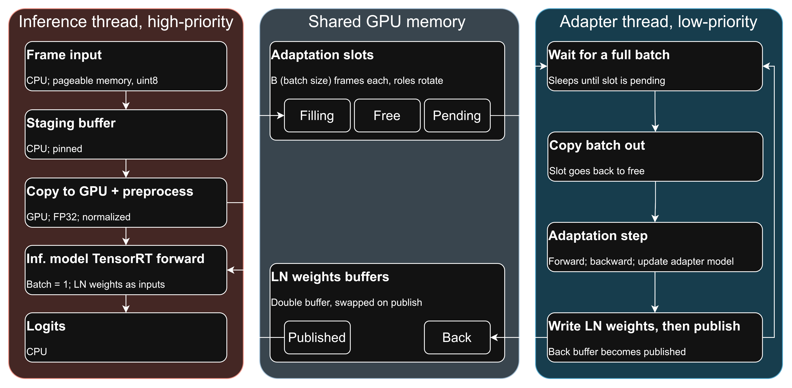

# Real-Time Test-Time Adaptation on TensorRT

A concept for real-time edge deployment of a test-time adaptation (TTA) method. TENT ([Wang et al., 2021](https://arxiv.org/abs/2006.10726)) adapts a ViT-B/16 classifier on the ImageNet-C benchmark in a continual setting, simulating a real-time camera stream. Inference runs in TensorRT FP16: the model is exported to ONNX, with the LayerNorm parameters exposed as graph inputs and softmax cast to FP32, and then built into a strongly typed TensorRT engine. Adaptation runs asynchronously in a separate thread, in PyTorch with a captured CUDA graph, and updates the engine's LayerNorm inputs with no engine refit. The system sustains up to 271 FPS on an RTX 3080, compared to 47 FPS for eager PyTorch, without losing accuracy. The repository also includes a naive eager PyTorch implementation for performance comparison and correctness checks.

The dependency versions were chosen to match JetPack 6.2, the software stack on Jetson Orin.

## Purpose of the project
This project is a proof of concept for deploying backpropagation-based test-time adaptation (TTA). It examines how such a method can be deployed and optimized with a modern software stack. It does not propose a new TTA method or aim to improve accuracy, which is why it uses one of the simplest TTA methods (TENT) on one of the simplest tasks (image classification). The design keeps the model always available for prediction and minimizes the computational impact of adaptation. 

The accuracy results compare the optimized pipeline against the naive eager PyTorch implementation used in almost all TTA papers. Their purpose is to verify that the optimized pipeline is correct. Keep in mind that TTA updates are unsupervised and therefore noisy. A faster pipeline can potentially perform more adaptation steps, but more steps do not necessarily lead to higher accuracy (see, e.g., [Niu et al., 2022](https://arxiv.org/abs/2204.02610), [Sreeram et al., 2026](https://arxiv.org/pdf/2602.06136)).



## Design decisions and tackled issues
- **Single frame at a time, simulating camera stream.** Every frame is predicted on its own (batch 1) as it arrives. Adaptation still uses batches of B adaptation frames (see below).
- **ViT architecture choice:** It avoids the issues related to BatchNorm layer's statistics update in ResNets. Additionally, [Niu et al., 2022](https://arxiv.org/abs/2204.02610) show that ViTs are more robust to distribution shifts than ResNets. 
- **LayerNorm (LN) params as engine inputs, zero-copy, no refit.** TENT adapts only the LayerNorm affine parameters. They enter the TensorRT engine as graph inputs, which costs no measurable time (GPU median about 1.1 - 1.3 ms either way). The engine keeps two packed LN params buffers, each bound once to its own execution context. The adapter writes new LN params into the back buffer in place and publishes it: the next frame reads it, and the old front buffer becomes the new back buffer. A publish copies nothing and leaves the engine unchanged. A refit instead costs 0.56 ms host + 0.45 ms GPU per update and cannot run while a frame is in flight, so a stall-free refit design needs two engines, doubling engine memory (2 × 176 MB, versus one shared engine plus 2 × 3.3 MB for buffers and contexts). See [ADR 0005](docs/adr/0005-layernorm-parameters-as-engine-inputs.md).
- **LayerNorm in FP32.** Each LayerNorm is computed in FP32 from FP32 LN params (`MixedPrecisionLayerNorm`, a cast to FP32 before and back to FP16 after). In FP16, small TENT updates (considering low LR) to LN would round away.
- **Softmax in FP32.** Attention softmax is wrapped in a cast pair after ONNX export. With FP16 softmax, prediction agreement fell below that of bf16 autocast on one of the domains. FP32 LayerNorm, FP32 softmax and LN params inputs together cost within 2% of inference GPU time.
- **Inference FP16, Adaptation bf16.** The backward pass needs range, so the adapter runs in bf16 autocast with FP32 weights. The LN params stay FP32 master copies, for the same rounding reason as above. Forward-only inference needs precision to match the FP32 reference, so the inference model is an FP16 TensorRT engine with LayerNorm and softmax in FP32.
- **Eager PyTorch TENT with gradient accumulation.** A single stream delivers one frame at a time, but TENT adapts on batches of B frames. Each adaptation frame runs one forward with grad, which gives its prediction, then one backward on loss / B into the accumulated gradients. Every B-th adaptation frame runs the SGD step and clears the gradients. With stride S, only every S-th frame is an adaptation frame, and the others run a no-grad forward (at S = 1, the published TENT, every frame adapts). Each adaptation frame pays 1 forward + 1 backward, memory does not depend on B, and frame latency stays even. The alternative, buffering B frames and re-running forward + backward at batch B, costs an extra forward per adaptation frame, memory ∝ B and a latency spike on every step frame. The decoupled optimized approach (`trt_tent`) uses that re-forward form, because there the extra forward runs off the inference thread and batch-B kernels use the GPU better.
- **Adapter step as one CUDA graph.** Forward, backward and the SGD update are captured as a single CUDA graph, so a step is one launch.

## Results
Measured on one RTX 3080 GPU.

**Baselines:**
- `EagerSource`: the frozen source model in eager PyTorch FP32, no adaptation.
- `EagerTENT`: standard TENT in eager PyTorch FP32. Adaptation mixed with inference: on every adaptation frame forward and backward is done (gradient accumulation, optimizer step every B adaptation frames).
- `TRTSource`: the frozen source model as a TensorRT FP16 engine (LayerNorm and softmax in FP32), no adaptation.
- `TRTTENT`: My optimized approach. The inference thread runs the TensorRT engine with the latest published LN params. Every S-th frame goes to a decoupled adapter thread, which runs the TENT step in PyTorch (CUDA graph) on its own lower-priority stream and publishes new LN params to the engine. Run in `spec` mode unless stated otherwise - adaptation on every adaptation batch. Can switch to `deploy` mode - bounded adaptation queue, drops the oldest adaptation batch if it cannot keep up with the rate if data input.

**Experimental details:**
_Max fps_ is the highest frame rate at which p99 end-to-end latency (from a frame's scheduled arrival until its prediction is on the host) stays within one frame interval, and in `spec` mode, the adapter's adaptation batch queue does not grow (it never fills its batch slots fully and it adapted to at least 98% of the adaptation batches). Measured by bisection on 2,000 dev frames first. Then, confirmed on two repeat replays, and step down by 2% of FPS until a full 7,500-frame run holds.

_Latency_ is measured per frame from its scheduled arrival to its prediction being consumed on the host, so it includes queueing behind earlier frames, host-to-device copy, GPU preprocessing, inference, the device-to-host copy of the logits and argmax.

Frame's scheduled arrival time is the time a camera running at exactly the target fps would deliver the frame.

B - batch size.
S - stride, every S-th frame is an adaptation frame.

**Results:**

| Method | B | S | p50 / p99 @ 30 fps (ms) | Max fps | Device GB | Acc. (%) |
| --- | --- | --- | --- | --- | --- | --- |
| `EagerSource` | - | - | 5.61 / 7.24 | 112 | 0.81 | 40.49 ± 0.00 |
| `TRTSource` | - | - | 1.48 / 1.76 | 697 | 0.49 | 40.49 ± 0.00 |
| `EagerTENT` | 1 | 1 | 16.28 / 19.94 | 46 | 0.94 | 46.16 ± 0.04 |
| `EagerTENT` | 16 | 1 | 16.21 / 20.33 | 47 | 0.94 | 46.10 ± 0.02 |
| `EagerTENT` | 64 | 1 | 15.96 / 19.88 | 47 | 0.94 | 45.89 ± 0.04 |
| `EagerTENT` | 16 | 2 | 12.71 / 18.44 | 54 | 0.94 | 44.62 ± 0.08 |
| `EagerTENT` | 16 | 8 | 5.63 / 17.17 | 59 | 0.94 | 42.19 ± 0.05 |
| `TRTTENT` | 1 | 1 | 1.71 / 1.96 | 171 | 1.37 | 46.16 ± 0.04 |
| `TRTTENT` | 16 | 1 | 1.48 / 3.27 | 271 | 2.18 | 46.10 ± 0.02 |
| `TRTTENT` | 64 | 1 | 1.38 / 4.58 | 214 | 4.63 | 45.89 ± 0.04 |
| `TRTTENT` | 16 | 2 | 1.48 / 3.13 | 256 | 2.18 | 44.62 ± 0.08 |
| `TRTTENT` | 16 | 8 | 1.48 / 1.86 | 272 | 2.18 | 42.19 ± 0.05 |

1. Every method, Eager included, sustains a 30 fps camera.
2. TensorRT TENT's max fps is 171 to 272, 4 to 6 times PyTorch TENT's 46 to 59, and 25 to 39% of TensorRT source's 697.
3. For B >= 16, max fps is capped by frames that run while an adaptation step is ongoing (see _During vs. w/o adaptation_ table).
4. `TRTTENT` at B = 1, S = 1 uses 1.37 GB vs `EagerTENT`'s 0.94 GB because it holds two copies of the model. The inference thread runs the TensorRT FP16 engine (176 MB plus its execution context and the TensorRT runtime), and the adapter keeps a full PyTorch FP32 ViT-B/16 for the TENT update. The adapter's CUDA graph also pins its own memory pool, so its forward activations and gradients stay reserved between steps instead of returning to the caching allocator. `EagerTENT` runs inference and adaptation on one PyTorch model. Above B = 1 the gap grows because the adapter's batch-B image buffer and activations scale with B (2.18 GB at B = 16, 4.63 GB at B = 64). `EagerTENT` accumulates gradients.
5. B `TRTTENT`: B = 16 has the highest max fps. B = 1 is throughput-bound. At B = 64 the adapter keeps up, but inference that run during an adaptation step get slower. They share SMs and memory bandwidth with it, and each of their kernels may wait briefly for running batch-64 blocks to free an SM. Accuracy is comparable.

**During vs. w/o adaptation:**
`TRTTENT` results.

| B | S | Max fps | Interval (ms) | % of frame with ongoing adaptation | p50 / p99 during adaptation (ms) | p50 / p99 w/o adaptation (ms) |
| --- | --- | --- | --- | --- | --- | --- |
| 1 | 1 | 171 | 5.86 | 100% | 1.61 / 1.70 | - |
| 16 | 1 | 271 | 3.70 | 81% | 2.71 / 3.24 | 1.36 / 1.47 |
| 64 | 1 | 214 | 4.68 | 54% | 3.90 / 4.60 | 1.33 / 1.49 |
| 16 | 2 | 256 | 3.91 | 37% | 2.73 / 3.16 | 1.33 / 1.45 |
| 16 | 8 | 272 | 3.68 | 10% | 2.79 / 3.13 | 1.32 / 1.42 |

**Engine variants: what the adaptable engine costs:**

| Engine | trtexec GPU median / p99 (ms) | `TRTSource` max fps | max abs logit difference vs PyTorch FP32 |
| --- | --- | --- | --- |
| LN params inputs, LN FP32, softmax FP32 (main) | 1.093 / 1.125 | 697 | 0.067 |
| LN params inputs, LN FP32, softmax FP16 | 1.080 / 1.114 | 693 | 0.069 |
| LN params inputs, LN FP16, softmax FP32 | 1.101 / 1.136 | 713 | 0.077 |
| LN params constant, LN FP32, softmax FP32 | 1.084 / 1.116 | 689 | 0.067 |
| LN params constant, LN FP16, softmax FP32 | 1.090 / 1.124 | 697 | 0.077 |

All variants are within 2% GPU time and within max fps noise. Making LN params engine inputs in FP32 costs nothing measurable on the 3080. All engines are 176 MB with 3 MB of activations.

**Adaptation correctness checks:**
On 30 FPS dev stream.

- Offline PyTorch FP32 deterministic TENT vs. `EagerTENT`: 100.00% prediction agreement - both FP32.
- Offline PyTorch FP32 deterministic TENT vs. `TRTTENT` spec: −0.07 to +0.01 pp accuracy difference, agreement 99.21 to 99.41% - due to FP16 and adaptation lag of 0/1 steps (asynchronous).

## Setup

### Requirements

- NVIDIA GPU (Compute capability 8.0 or newer (Ampere+))
- NVIDIA driver 560 or newer.
- Docker with the [NVIDIA Container Toolkit](https://docs.nvidia.com/datacenter/cloud-native/container-toolkit/latest/install-guide.html)
- Docker Compose v2 or newer.
- About 25 GB free under Docker's data root for the image, and about 60 GB in the data directory for ImageNet-C (tars plus subset)

### Installation

1. Create `.env` for your machine. Set `HOST_DATA_DIR` which will hold everything that is not source code: datasets, checkpoints, TensorRT engines, run outputs, logs and caches. It will be mounted at `/data` in the container.

   ```bash
   cp .env.example .env
   sed -i "s/^HOST_UID=.*/HOST_UID=$(id -u)/; s/^HOST_GID=.*/HOST_GID=$(id -g)/" .env
   ```

2. Create the data directory.

   ```bash
   mkdir -p "$(grep '^HOST_DATA_DIR=' .env | cut -d= -f2-)"
   ```

3. Build the image (NGC PyTorch 24.08: PyTorch 2.5, CUDA 12.6, cuDNN 9.3, TensorRT 10.3, matching JetPack 6.2).

   ```bash
   docker compose build
   ```

### Data

ImageNet-C ([Hendrycks and Dietterich, 2019](https://zenodo.org/records/2235448)), severity 5, all 15 corruptions, restricted to the RobustBench ([Croce et al., 2021](https://github.com/RobustBench/robustbench)) 5,000-image subset.

1. Download the four corruption families (about 50 GB, resumable) and verify their checksums. The `extra` family is not used.

   ```bash
   docker compose run --rm tta bash -c '
     mkdir -p /data/downloads/imagenet-c && cd /data/downloads/imagenet-c
     for f in blur digital noise weather; do
       wget -c --tries=20 --retry-connrefused -O $f.tar \
         https://zenodo.org/api/records/2235448/files/$f.tar/content
     done
     md5sum -c <<EOF
   2d8e81fdd8e07fef67b9334fa635e45c  blur.tar
   89157860d7b10d5797849337ca2e5c03  digital.tar
   e80562d7f6c3f8834afb1ecf27252745  noise.tar
   33ffea4db4d93fe4a428c40a6ce0c25d  weather.tar
   EOF'
   ```

   Rerun the same command to resume an interrupted download.

2. Extract the subset and build the manifests. Only `<corruption>/5/<class>/<file>` entries on the RobustBench subset of ImageNet-C are written to `/data/datasets/imagenet-c`. Once all 15 corruptions are present, the script verifies every SHA-256 and writes `manifests/imagenet_c_s5_full.csv` (75,000 images) and `manifests/imagenet_c_s5_dev.csv` (7,500 images).

   ```bash
   docker compose run --rm tta python scripts/extract_imagenet_c.py \
     /data/downloads/imagenet-c/{blur,digital,noise,weather}.tar
   ```

3. Optionally delete the tars once extraction is done: `rm -r /data/downloads/imagenet-c` (inside the container).

## Running

All code runs inside the container.

```bash
docker compose run --rm tta                     # interactive shell
docker compose run --rm tta python -m pytest    # one-off command
```

Inside the container:

| Path | Contents |
| --- | --- |
| `/workspace/deployment_tta` | This repository, mounted read-write. `src/` is on `PYTHONPATH`. |
| `/data` | The data directory (`HOST_DATA_DIR`), also in `$DATA_DIR`. |

### Format, lint, type check

```bash
docker compose run --rm tta ruff format .              # format
docker compose run --rm tta ruff check --fix .         # lint, apply safe fixes
docker compose run --rm tta docformatter -i src scripts tests  # wrap docstrings
docker compose run --rm tta mypy src scripts tests     # type check
```

### Experiments

```bash
python scripts/engines.py                    # build every TensorRT engine + parity record (run first)
python scripts/orchestrate.py experiments/reference.yaml --subset full  # reference: source + TENT grid, FP32 deterministic, the reported accuracy
python scripts/orchestrate.py experiments/realtime.yaml   # whole dev stream per method at 30 fps, deploy mode (16, 1) at 30 to 720 fps
python scripts/orchestrate.py experiments/max_fps.yaml    # max sustainable fps per method, whole-dev-stream live run that held, trt_tent 3 repeats
python scripts/run.py --method trt_tent --mode deploy --B 16 --S 1 --fps 240   # one live run of one method, to /data/runs/dev/realtime/<method>/fps240_seed1/
python scripts/orchestrate.py experiments/trtexec.yaml    # GPU time (trtexec) and sizes of every engine
python scripts/orchestrate.py experiments/adapter.yaml    # standalone adapter step per B (m = B, graph)
python scripts/refit_bench.py                # refit cost of a constant-γ/β engine (ADR 0005)
python scripts/report.py --subset full       # main table: dev timing + full reference, to /data/runs/full/report/
```

| Output | Path |
| --- | --- |
| Engines + records | `/data/engines/` |
| Real-time runs | `/data/runs/<subset>/realtime/<method>/fps<f>_seed<n>/` |
| Max fps | `/data/runs/<subset>/max_fps/<method>/seed<n>/` |
| Reference, lag sim | `/data/runs/<subset>/offline/seed<n>/` |
| Benchmarks | `/data/runs/bench/` |
| Report | `/data/runs/<subset>/report/` |

## License

MIT. See [LICENSE](LICENSE).